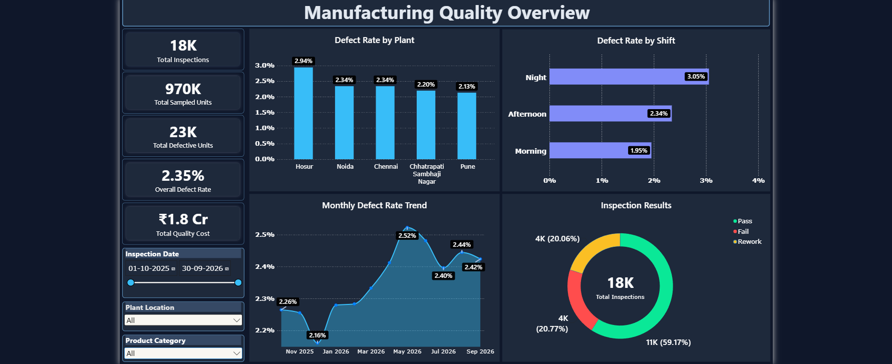
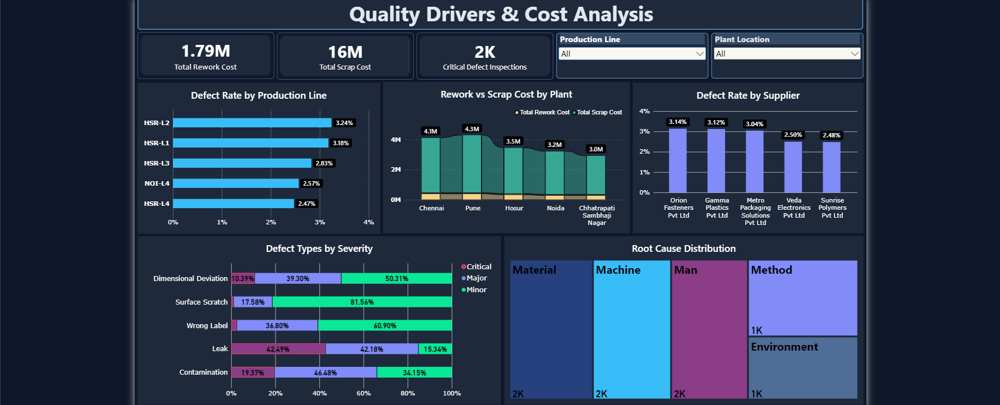

# Manufacturing Quality Performance Analysis - Power BI

This project analyzes manufacturing quality inspection data to identify patterns in product defects, compare quality performance across plants, production 
lines, shifts, and suppliers, and evaluate the financial impact of rework and scrap using Excel, Python, MySQL, and Power BI. The objective is to transform raw 
inspection data into meaningful business insights that can help identify quality issues and support data-driven decision-making.

---

## 🎯 Project Objectives

- Analyze overall manufacturing inspection performance.
- Measure defect rates across different plants, production lines, and shifts.
- Identify defect severity patterns and frequently occurring defects.
- Evaluate supplier-wise and production-line quality performance.
- Analyze root causes associated with manufacturing defects.
- Understand the financial impact of rework and scrap costs.

---

## 📊 Dataset

- **Dataset Type:**  Manufacturing Quality Inspection Data
- **Initial Records:**  18,313
- **Original Columns:**  29
- **Data Period:**  October 2025 – September 2026
- **Final Dataset:** 18,000 records with 30 columns

---

## 🛠️ Tools

- Microsoft Excel:  Initial data auditing, inspection, and basic data cleaning.
- Python (pandas & numpy):  Data cleaning, handling missing values, duplicate checks, transformation, standardization and validation.
- MySQL:  SQL-based business analysis, aggregations, and answering business questions.
- Power BI:  Interactive dashboards and data visualization.

---

## 🧹 Data Preparation

- Used Pandas and NumPy for data cleaning and transformation.
- Removed exact duplicate records.
- Handled missing and inconsistent values.
- Standardized categorical values and naming conventions.
- Corrected invalid data formats and data types.
- Identified and handled invalid numerical values.
- Validated business rules, such as defective units not exceeding sampled units.
- Prepared the cleaned dataset for further analysis.

---

## 📊 Key Business Questions

1. What is the overall manufacturing quality performance in terms of inspections, sampled units, defective units, and defect rate?
2. Which manufacturing plants have the highest defect rates and quality-related costs?
3. How does quality performance vary across different production shifts?
4. Which production lines and suppliers have comparatively higher defect rates?
5. What are the most significant defect severity categories and their associated root causes?
6. How are quality-related costs distributed between rework and scrap across different plants?

---

## 🔎 Business Analysis – MySQL

- Imported the cleaned dataset into MySQL.
- Used SQL queries to perform aggregations and comparisons.
- Analyzed defect rates across plants, shifts, and production lines.
- Evaluated supplier performance and defect severity.
- Examined rework and scrap costs.
- Answered key business questions using SQL.

---

## 📐 Important Key Metrics

1. Defect Rate (%):
The defect rate measures the proportion of defective units identified within the inspected sample.
Defect Rate = (Total Defective Units / Total Sampled Units) × 100

3. Total Quality Cost (Rs):
Represents the combined cost of rework and scrap, indicating the financial impact of manufacturing defects.
Total Quality Cost = Total Rework Cost + Total Scrap Cost

---

## 📈 Dashboards

### Dashboard 1 – Manufacturing Quality Overview
Provides an overview of manufacturing quality through key performance indicators such as total inspections, sampled units, defective units, and defect rate. 
Analyzes quality trends across plants, shifts, and time periods to identify overall production quality performance.

### Dashboard 2 – Quality Drivers & Cost Analysis
Focuses on identifying major quality issues by analyzing defect rates across production lines and suppliers, defect severity, and root causes. Also evaluates 
rework and scrap costs to understand the financial impact of manufacturing defects.

---

## 🖼️ Screenshots

### Dashboard 1

### Dashboard 2

---

## 💡 Key Findings

1. Plant Performance — **Hosur** recorded a relatively high defect rate (2.94%) & **Pune PUN-L3** performed best at 2.13%.
2. Shift Analysis — The **Night Shift** had the highest defect rate overall, at 3.05%.
3. Defect Analysis — **Surface Scratch** leads in minor-defect count (1,141) & **Leaks** show the highest critical-severity count (410).
4. Supplier Quality — **Orion Fasteners** had the highest supplier defect rate & **Apex Castings** had the lowest.
5. Quality Trends — Defect rate peaked in **May 2026** at 2.52%.
6. Quality Costs — **Scrap costs** exceeded rework costs, with **Pune PUN-L4** recording the highest combined cost.

---

## 👨‍💻 Author

**Krishna Thombare**

